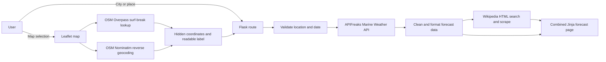

# Breakline Surf Forecasts

Breakline is a Flask web application that turns marine-weather data into a concise, human-readable surf outlook. Users can search by city or select a coastal point on an interactive map. The application combines an APIFreaks marine forecast, OpenStreetMap location data, and a short Wikipedia overview when a relevant beach, city, or surf-break article exists.

This phase expands the original local-data prototype into an external information acquisition application. Weather conditions are requested at runtime, map selections are enriched with nearby place and surf-break names, and supporting destination information is scraped from public Wikipedia HTML.

## External Information Sources

| Source | Endpoint or website | Purpose |
|---|---|---|
| APIFreaks Marine Weather API | `GET https://api.apifreaks.com/v1.0/weather/marine` | Retrieves daily wave height, wave direction, wave period, swell, and wind-wave conditions by coordinates or location name. |
| OpenStreetMap raster tiles | `https://tile.openstreetmap.org/{z}/{x}/{y}.png` | Displays the interactive location picker. |
| OpenStreetMap Overpass API | `https://overpass-api.de/api/interpreter` with a fallback to `https://overpass.kumi.systems/api/interpreter` | Finds the nearest named OpenStreetMap feature tagged `sport=surfing`. |
| OpenStreetMap Nominatim | `GET https://nominatim.openstreetmap.org/reverse` | Converts a selected coordinate into a human-readable city or regional name. |
| English Wikipedia | `https://en.wikipedia.org/w/index.php` and selected `/wiki/...` articles | Searches rendered HTML for a relevant beach, surf-break, or coastal-city page and scrapes its introductory text. The Wikipedia API is not used. |

APIFreaks requests authenticate through the server-side `X-apiKey` header. Browser requests to OpenStreetMap retain visible attribution, and scraped Wikipedia content links to its source article.

## Application Workflow



1. The user chooses either **Pick on map** or **City or place**.
2. A map click stores latitude and longitude in hidden form fields. Overpass attempts to identify a nearby surf break, while Nominatim supplies a readable city or region.
3. Flask validates the lookup mode, coordinates or location name, and forecast date.
4. The server requests a daily marine forecast from APIFreaks.
5. Returned metric wave heights are converted to feet, directions are converted to cardinal labels, and missing measurements receive readable fallback text.
6. The server searches Wikipedia's rendered HTML for a relevant article and extracts up to two useful introductory paragraphs.
7. The forecast and optional Wikipedia overview are rendered together. A Wikipedia failure never blocks the marine forecast.

## Information Model

Breakline currently uses an in-memory request/response model. Persistent storage is planned for A3.

| Entity | Attributes | Origin |
|---|---|---|
| Forecast request | lookup mode, location text, hidden latitude, hidden longitude, readable selected city, surf-break name, forecast date | Local user input and browser state |
| Marine location | city, state/province, country, latitude, longitude | External: APIFreaks |
| Marine conditions | maximum wave height, dominant wave direction, maximum wave period, swell height/direction/period, wind-wave height | External: APIFreaks |
| Surf-break match | name, latitude, longitude, distance from selected point | External: OpenStreetMap Overpass |
| Readable map location | city/town/village/municipality/county, state | External: OpenStreetMap Nominatim |
| Wikipedia overview | article title, cleaned introductory summary, canonical source URL | External: scraped Wikipedia HTML |
| Surf-spot sample | name, region, sample wave/swell/wind/tide/rating fields in `data/surf_spots.json` | Local legacy prototype data; not used for live forecasts |
| Application configuration | API key, service base URLs, Flask environment, secret key | Local environment variables |

No forecast history, user account, saved location, or scraped article is currently stored in a database. The Wikipedia scraper keeps a small in-process cache for repeated lookups during the running process.

## Environment Variables

Copy `.env.example` to `.env`. Never commit `.env` or an actual API key.

| Variable | Required | Description |
|---|---:|---|
| `APIFREAKS_API_KEY` | Yes | APIFreaks credential used only by the Flask server. |
| `SECRET_KEY` | Recommended | Flask signing secret. The development fallback is not appropriate for production. |
| `FLASK_ENV` | No | `development` or `production`; defaults to development configuration. |
| `APIFREAKS_BASE_URL` | No | Overrides the default APIFreaks base URL. Useful for testing. |
| `WIKIPEDIA_BASE_URL` | No | Overrides `https://en.wikipedia.org`. Useful for testing. |
| `API_KEY` | No | Legacy generic service configuration; not used by the marine forecast. |
| `AI_SERVICE_API_KEY` | No | Reserved for the placeholder AI service; not used by current features. |

Example `.env`:

```dotenv
SECRET_KEY=replace-with-a-random-secret
APIFREAKS_API_KEY=replace-with-your-apifreaks-api-key
FLASK_ENV=development
```

## Installation Instructions

Prerequisites:

- Python 3.10 or newer
- Git
- An APIFreaks account and Marine Weather API key
- Internet access for APIFreaks, OpenStreetMap, Leaflet assets, and Wikipedia

Setup:

```bash
git clone <repository-url>
cd profthoms-it401-final-project

python3 -m venv .venv
source .venv/bin/activate          # macOS/Linux
# .venv\Scripts\activate           # Windows PowerShell

pip install -r requirements.txt
cp .env.example .env
```

Edit `.env`, replace only the placeholder values, and then start the app:

```bash
python app.py
```

The default address is [http://127.0.0.1:5000](http://127.0.0.1:5000). If port 5000 is occupied, use Flask's CLI to choose another port:

```bash
flask --app app run --debug --port 5001
```

Core dependencies are Flask, Requests, Beautiful Soup 4, python-dotenv, and pytest. Exact minimum versions are declared in `requirements.txt`.

Run the automated tests with:

```bash
python -m pytest -q
```

## Current Features

- **API integration:** Retrieves current-date through 16-day daily forecasts from APIFreaks by city/place or coordinates.
- **Interactive map:** Uses Leaflet and OpenStreetMap tiles; map coordinates remain hidden from users.
- **Human-readable map selection:** Resolves the chosen point to a nearby city or region and attempts to identify a named surf break.
- **Web scraping:** Searches Wikipedia result pages, selects a relevant article, and extracts introductory paragraphs from rendered HTML.
- **Data cleaning:** Trims input, validates ranges and lengths, removes citation/style elements from scraped paragraphs, normalizes whitespace, truncates summaries, converts meters to feet, and converts degrees to cardinal directions.
- **User search and filtering:** Supports map or city lookup modes, only accepts current/future dates within the API's 16-day window, and filters OpenStreetMap results to named surfing features rather than shops, schools, or clubs.
- **Responsive presentation:** Combines forecast data, location context, and optional scraped information in a mobile-friendly interface.
- **Error handling:** Presents user-safe messages and isolates optional-source failures from the primary forecast.

## Error Handling

| Failure | Application behavior |
|---|---|
| Missing `APIFREAKS_API_KEY` | No external weather request is made. The page explains that the server must be configured. |
| APIFreaks authentication error (`401`/`403`) | Displays a configuration message without revealing the key. |
| Invalid APIFreaks request (`400`) | Explains that the coordinates or date were rejected. |
| Location not found (`404`) | Reports that no forecast was found for the selected location. |
| Timeout, connection error, invalid JSON, or other API error | Displays a retry-friendly service-unavailable message. |
| Invalid coordinate | Enforces latitude `-90..90` and longitude `-180..180` on the server. |
| Invalid location text | Rejects blank values and values longer than 150 characters. |
| Invalid forecast date | Accepts only today through 16 days ahead. |
| Missing forecast fields | Displays `Not available` instead of failing template rendering. |
| Overpass unavailable or no surf-break match | Keeps the originally selected coordinate and falls back to its readable city/region when possible. |
| Reverse geocoding unavailable | Keeps the hidden coordinates and displays a generic location-selected message. |
| Wikipedia request failure or timeout | Omits the optional overview; the marine forecast still renders. |
| Missing or changed Wikipedia HTML elements | Returns no overview when a heading or useful paragraph cannot be extracted. Current and legacy paragraph nesting are both supported. |

## Ethical Considerations

- **Attribution:** OpenStreetMap attribution remains visible on the map. Every displayed Wikipedia summary names Wikipedia contributors, links to the source article, identifies the CC BY-SA 4.0 license, and notes that the text was shortened.
- **API credentials:** The APIFreaks key remains server-side and is never included in HTML, JavaScript, screenshots, or documentation.
- **Rate limits:** Map lookups occur only after direct user actions. Requests use timeouts and cancellation, and the application does not bulk-download map or geocoding data. Nominatim's public service requires an application-wide maximum of one request per second; a production deployment should add server-side throttling/caching or use a dedicated provider.
- **Responsible scraping:** The scraper uses a descriptive user agent, requests only search and selected article pages, caches repeated queries in memory, limits extracted text, and fails closed when expected content is missing. Before production deployment, verify Wikipedia's current robots, terms, and markup requirements.
- **Source limitations:** Wikipedia and OpenStreetMap are community-maintained sources. Their presence does not guarantee that a surf break is mapped, that an article exists, or that the information is complete.

## Known Limitations

- Public Overpass and Nominatim services are best-effort and may be slow, unavailable, or rate-limited.
- OpenStreetMap surf-break coverage varies by region. The nearest mapped `sport=surfing` feature may not be the user's intended break.
- Reverse geocoding finds the closest suitable mapped object, which may occasionally return a neighboring municipality.
- Wikipedia HTML can change and break scraper selectors. Search ranking may select a city article when a dedicated surf-break article does not exist.
- The English Wikipedia is the only scraped language source.
- Daily APIFreaks data is shown; hourly and minutely forecasts are not yet exposed.
- Surf suitability is not scored. Break orientation, bathymetry, local hazards, wind weather, and tides require additional sources.
- External results are fetched during a page request, so slow sources can increase response time.
- There is no database, user authentication, saved locations, favorites, or forecast history.

## Screenshots

### Homepage


### API results


### Scraped results


### Combined interface


## Project Structure

```text
.
├── app.py
├── config.py
├── data/
├── models/
├── routes/
│   └── main.py
├── services/
│   ├── marine_weather_service.py
│   └── wikipedia_scraper.py
├── static/
│   ├── map.js
│   └── style.css
├── templates/
├── tests/
├── .env.example
└── requirements.txt
```

## Future Work: A3 Persistent Storage

A3 will introduce a database-backed information layer. Planned work includes:

- Store normalized surf spots with canonical names, coordinates, region, and source identifiers.
- Cache marine forecasts with retrieval timestamps and expiration rules to reduce duplicate API calls.
- Persist cleaned Wikipedia summaries with article URLs, last-checked timestamps, and content provenance.
- Save OpenStreetMap surf-break matches and reverse-geocoded labels while respecting source terms.
- Add user accounts, favorite breaks, recent searches, and saved forecast preferences.
- Track API and scraping failures for maintenance without storing secrets or unnecessary personal data.
- Add database migrations, repository/model tests, and a scheduled refresh strategy for stale external information.

Persistent records will distinguish local user/application data from externally acquired data and retain source, retrieval time, and attribution metadata for every imported record.
