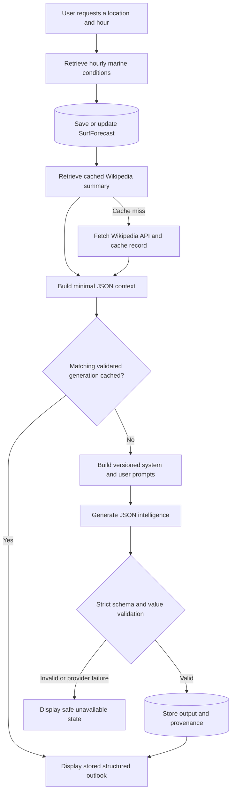
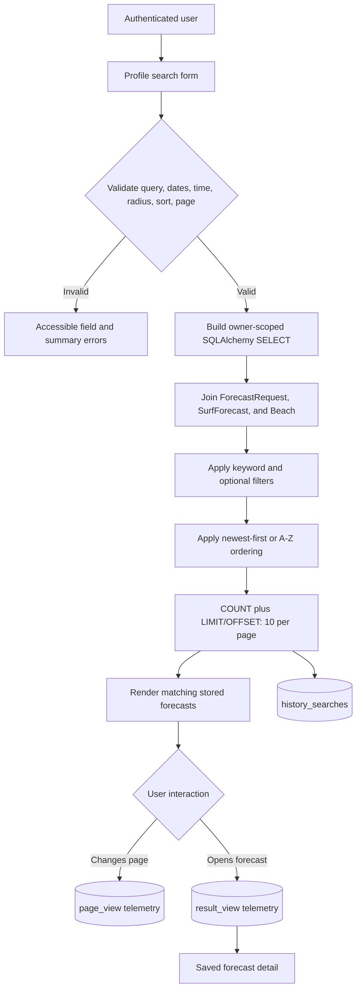
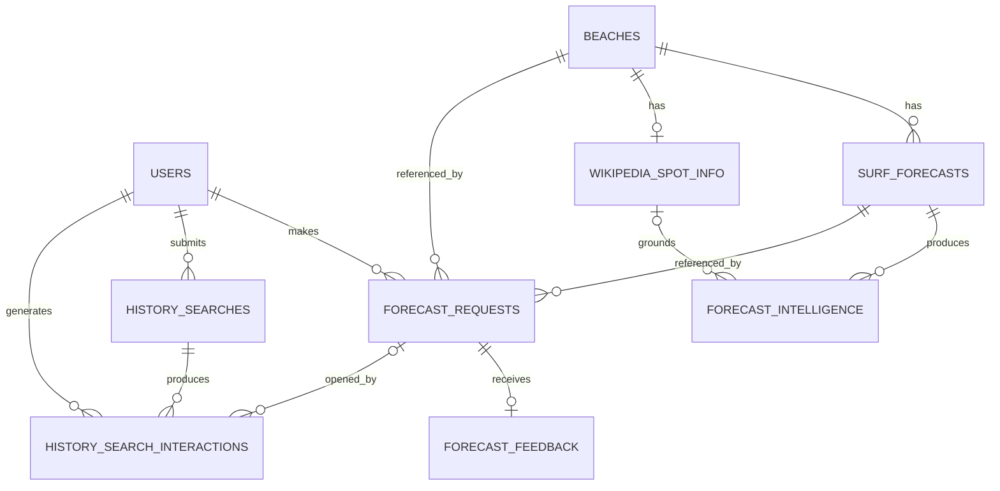

# Project Title

- **Application name:** Breakline Surf Forecasts
- **Student:** Brian Thoms
- **Course:** IT 401
- **Assignment:** A5 — Expanding the Web Intelligence Application with Intelligence Generation

## Project Overview

Breakline is a Flask application that helps surfers find and revisit useful marine forecasts. A user can request an hourly forecast by city, by selecting a point on a Leaflet map, or by granting browser location access and using the nearest named beach or surf break. Breakline combines APIFreaks marine-weather data, OpenStreetMap coastal information, and short Wikipedia overviews, then persists successful forecasts in MySQL through Flask-SQLAlchemy.

The application's purpose is to reduce the time required to compare coastal conditions and make a surfing plan. Its intended users are surfers and coastal visitors who want a readable forecast for a specific place and hour.

Authenticated users receive a private forecast history. A4 search improves the original application by making that history retrievable rather than merely chronological. Users can search across beach and surf-spot names, combine filters, sort results, page through large histories, reopen stored reports without another weather API call, and search within a radius of their current location.

A5 adds a retrieval-augmented classification and summarization feature. After a successful lookup, Breakline uses the saved `SurfForecast` row and that beach's cached Wikipedia summary to produce a validated JSON outlook: a fixed `Flat`, `Poor`, `Fair`, `Good`, or `Epic` rating; a 2–3 sentence summary; numeric confidence; and a list of missing information. The rating fills the forecast card's former “Hourly marine outlook” placeholder, while the explanation and provenance appear directly below it.

## A5 Deliverable Map

| Assignment requirement | Project evidence |
|---|---|
| New A5 branch | `profthoms-it401-a5` |
| Extend the A4 application | Existing Flask, SQLAlchemy, MySQL, search, filtering, ranking, and history workflows remain in place. |
| Intelligent capability | Classification plus summarization in `services/intelligence_service.py`; rendered in `templates/_forecast_report.html`. |
| Retrieval-augmented workflow | `routes/main.py` persists/retrieves the forecast and Wikipedia cache before building model context. The diagram below documents the sequence. |
| Prompt construction | Versioned system instructions and user/context organization in `services/intelligence_prompts.py`. |
| Structured output | JSON-only schema with `rating`, `summary`, `confidence`, and `missing_info`. |
| Output validation | Strict parser and allow lists in `services/intelligence_validator.py`; invalid output is neither displayed nor stored. |
| Generated-intelligence storage | `ForecastIntelligence` stores output, model, prompt version, generation time, source-record IDs, user request, and a context hash. |
| Reliability | Safe handling for missing key/context, rate limits, timeouts, provider/JSON failures, invalid output, and database errors. |
| Application organization | Models, prompts, validation, HTTP provider client, orchestration, and persistence are separated by responsibility. |
| Automated evaluation | Intelligence, catalog, forecast, authentication, and retrieval coverage; complete suite: 47 passing tests. |
| README and PDF evidence | This README contains every required A5 discussion. The screenshot/PDF capture checklist below identifies the live evidence still to capture after configuring the real services. |

## Intelligence Generation

### Selected capability and purpose

Breakline combines **text classification** and **summarization**. Raw wave height, direction, period, swell, and wind-wave fields are useful to an experienced surfer but still require interpretation. The generated result turns those retrieved values into a consistent, scannable rating and a short explanation while explicitly showing uncertainty and missing inputs. This was chosen because it adds value in the forecast's main decision point without creating a separate AI demonstration or replacing the original measurements.

### Retrieval-augmented workflow



The model operates only after a `SurfForecast` has been persisted and a non-empty cached Wikipedia summary is available. The context contains the forecast date/hour, seven marine measurements with explicit units, and the cached article title/summary. API keys, user identity, coordinates, unrelated database rows, Wikipedia URLs/licensing fields, and search telemetry are excluded because they do not help classify the retrieved conditions.

### Prompt design

- **System instructions:** establish the model's role, prohibit outside facts, constrain the five ratings, define the four exact JSON keys, require a 2–3 sentence summary, bound confidence to `0–1`, and define `missing_info`.
- **User prompt:** states the fixed application request, labels the retrieved context, serializes it as deterministic JSON, and repeats the JSON-only response instruction.
- **Retrieved context:** separates `saved_surf_forecast` from `cached_wikipedia_summary` and declares meters, degrees, and seconds so values are not misinterpreted.
- **Output format:** `{ "rating": "Good", "summary": "...", "confidence": 0.82, "missing_info": ["wind speed and direction", "tide stage"] }`.
- **Versioning:** `surf-outlook-v1` is stored with each generation so prompt changes can be evaluated without confusing old and new output.

Context improves quality by grounding the explanation in the same persisted evidence the user sees. It also makes the request reproducible: canonical context is SHA-256 hashed, and an identical forecast/context/model/prompt combination reuses the stored generation instead of calling the model again.

### AI component

`AiService` calls an OpenAI-compatible Chat Completions endpoint server-side with JSON response mode, low temperature, and a configurable timeout. The default endpoint is OpenAI and the default model is `gpt-4o-mini`; both can be replaced through environment variables without changing application code. The API key is sent only in the server-side authorization header and is never placed in a prompt, URL, template, database row, or client response.

### Validation and fallback behavior

The application treats model output as untrusted. `validate_intelligence_output()` requires a JSON object with exactly four expected fields, checks the fixed rating allow list, normalizes whitespace, requires a 40–900 character summary with 2–3 sentences, accepts only a non-boolean numeric confidence from 0 through 1, and validates a bounded list of short missing-information strings. Markdown fences, prose around JSON, missing/extra keys, invalid ratings, wrong types, excessive text, and out-of-range confidence are rejected.

When generation cannot safely complete, the original forecast remains usable and the rating slot says the AI outlook is unavailable. A missing source record prevents generation. A missing key, timeout, rate limit, network/provider failure, or invalid response produces a user-safe status and no stored generation. A cache-read database error is rolled back. If validated output is produced but its database write fails, it may be shown for the current request with an explicit not-stored status; the transaction is rolled back and the failure is logged.

### Generated intelligence example

```json
{
  "rating": "Good",
  "summary": "The saved forecast shows a solid swell with a useful period. Conditions look promising, although wind speed and tide are unavailable.",
  "confidence": 0.82,
  "missing_info": ["wind speed and direction", "tide stage"]
}
```

Simple retrieval could display only the source values and article. This result adds a consistent application-specific classification, explains the basis in plain language, and makes uncertainty visible. It is decision support rather than a safety guarantee; users must still check local observations, hazards, tide, and official sources.

## Search and Retrieval Features

| Capability | Implementation |
|---|---|
| Keyword search | Case-insensitive substring search for a beach, city, requested location, or surf spot. |
| Fields searched | `ForecastRequest.surf_break_name`, `ForecastRequest.requested_location`, `Beach.name`, and `Beach.city`. |
| Filters | Forecast start/end dates, time of day, current-location radius, and an implicit authenticated-user filter. |
| Time groups | Overnight `00–04`, morning `05–11`, afternoon `12–16`, and evening `17–23`. |
| Radius search | Haversine distance in SQL, from 1 through 100 miles; the results page also displays each distance. |
| Sorting | Newest request first or surf-spot name A–Z. |
| Ranking | Deterministic rule-based ordering rather than a relevance score. Newest-first uses request time; A–Z uses the displayed spot name. Request ID is the final tie-breaker. |
| Pagination | Database-backed pagination with 10 results per page, a total-count query, numbered links, and previous/next controls. |
| Search telemetry | Valid search criteria and result counts are recorded. Pagination views and forecast-result views are recorded as interactions. |
| Search recall | Shows matched forecasts as a count and percentage of the signed-in user's complete forecast history. |

Searches always include `ForecastRequest.user_id == current_user.id`; one user cannot search or open another user's history.

## Search Workflow



1. Flask normalizes and validates the submitted GET parameters.
2. The repository builds a SQL query restricted to the signed-in user.
3. Keyword and structured filters are combined with SQL `AND`; the keyword fields are combined with SQL `OR`.
4. SQL ordering and pagination are applied before records are returned to the browser.
5. The rendered page preserves active filters, sort order, location context, and telemetry search ID in pagination links.
6. Valid new searches, page views, and result views are stored for later evaluation. Invalid and empty searches are not recorded.

## Searchable Information

| Model | Searchable fields | Filter fields | Ranking/sorting fields | Reason |
|---|---|---|---|---|
| `ForecastRequest` | `surf_break_name`, `requested_location` | `user_id` | `requested_at`, `id` | Contains the user's original label, selected break, ownership, and request chronology. |
| `Beach` | `name`, `city` | `latitude`, `longitude` through calculated distance | `name` through the displayed-name expression | Supplies normalized location names and coordinates. |
| `SurfForecast` | None in the keyword expression | `forecast_date`, `forecast_hour` | None currently | Dates and hours are structured values and are more precise as filters than text. |
| `HistorySearch` | Not exposed as user-searchable content | User and timestamp support later analysis | Not used in live result ranking yet | Retains search intent and result-count signals for evaluation. |
| `HistorySearchInteraction` | Not exposed as user-searchable content | Search, user, interaction type, page, and position | Not used in live result ranking yet | Retains engagement signals for future recommendations. |

The displayed-name expression uses the first available value from surf-break name, beach name, and requested location. That same priority is used for alphabetical ordering so the table label and database ordering agree.

## Retrieval Strategy

### Keyword matching

The search repository escapes `%`, `_`, and backslash characters, adds `%` around the normalized query, and applies SQLAlchemy `ilike()` to four fields. The expression is equivalent to:

```sql
WHERE user_id = :current_user
  AND (
    surf_break_name ILIKE :pattern
    OR requested_location ILIKE :pattern
    OR beach.name ILIKE :pattern
    OR beach.city ILIKE :pattern
  )
```

SQLAlchemy translates `ILIKE` appropriately for the configured database. This project does not currently use MySQL full-text indexes, stemming, fuzzy matching, or embeddings.

### Combining filters

- Fields inside keyword search are combined with `OR`.
- Keyword, date range, time group, and radius constraints are combined with `AND`.
- Start and end dates are independently optional and inclusive.
- Time groups translate to an inclusive `forecast_hour BETWEEN first_hour AND last_hour` condition.
- Radius uses the Haversine formula against stored `Beach.latitude` and `Beach.longitude` values.
- The authenticated-user predicate is always present.

### Sorting and ranking

The default order is `requested_at DESC, id DESC`. Alphabetical order uses a lowercase `COALESCE` display-name expression followed by request time and ID as deterministic tie-breakers. This is rule-based ranking: keyword matches do not receive different relevance scores based on the matched field or term position.

### Retrieval limitations

- Substring matching does not understand meaning, synonyms, misspellings, or word importance.
- Singular and plural forms can differ.
- Every matching text field has equal weight.
- A query such as `HB` will not automatically expand to `Huntington Beach`.
- Radius results are filtered by distance but are not currently sorted by nearest distance.
- Pagination uses offset-based retrieval; very large histories may eventually benefit from cursor pagination.

## Search Telemetry

Breakline records first-party telemetry only for authenticated users and valid searches.

### Recorded search activity

`history_searches` stores:

- user ID;
- keyword text;
- forecast start and end dates;
- time-of-day filter;
- whether a location radius was used;
- radius in miles;
- sort order;
- total result count; and
- creation timestamp.

For privacy, telemetry does **not** store the user's precise current latitude, longitude, or reverse-geocoded current-location label.

`history_search_interactions` stores:

- user ID and optional originating search ID;
- optional forecast-request ID;
- interaction type (`page_view` or `result_view`);
- page number;
- absolute result position; and
- interaction timestamp.

Invalid searches create no telemetry. Telemetry writes are isolated from search delivery: a telemetry database failure is rolled back and logged without blocking valid results.

### Why telemetry is recorded

These records can reveal common query vocabulary, filters that produce zero results, popular time windows, frequently opened surf spots, and the positions at which users engage. Future retrieval can use aggregate signals to improve query suggestions, ranking, and recommendations. Before personalization, the project should add retention rules, user-facing privacy language, result-impression events, and a method for users to delete their activity.

## Database Schema

| Table | Purpose | Primary key | Important attributes | Relationships |
|---|---|---|---|---|
| `users` | Local profile for Google-authenticated users | `id` | `google_sub`, email, display name, avatar, timestamps | One-to-many forecast requests, history searches, and interactions |
| `beaches` | Normalized beach/coastal location | `id` | name, city, state/province, country, latitude, longitude | One-to-many forecasts; one-to-one Wikipedia info |
| `surf_forecasts` | Persisted hourly APIFreaks conditions | `id` | beach, date, hour, wave/swell/wind-wave values, source, retrieval time | Many-to-one beach; referenced by forecast requests |
| `forecast_requests` | Authenticated user's successful forecast history | `id` | user, beach, forecast, lookup mode, requested location, surf-break name, timestamp | Many-to-one user, beach, and surf forecast |
| `forecast_feedback` | User rating and optional comments for a saved forecast request | `id` | forecast request, 1–5 rating, comment, created/updated timestamps | One-to-one forecast request |
| `wikipedia_spot_info` | Cached Wikipedia API overview and provenance | `id` | page/revision IDs, summary, URL, license, timestamps | One-to-one beach |
| `forecast_intelligence` | Validated generated classification, summary, and provenance | `id` | rating, summary, confidence, missing info, output JSON, model, prompt version, context hash, source records, user request, timestamp | Many-to-one surf forecast; optional Wikipedia source FK |
| `surf_spots` | Reviewed local surf-break catalog | `id` | canonical name, slug, region, coordinates, source/license, active state | One-to-many aliases |
| `surf_spot_aliases` | Search vocabulary for catalog spots | `id` | display alias, normalized alias, source | Many-to-one surf spot |
| `history_searches` | One valid profile-history search | `id` | filters, radius usage, sort, result count, timestamp | Many-to-one user; one-to-many interactions |
| `history_search_interactions` | Search-results engagement event | `id` | type, page, position, timestamp | Many-to-one user and optional search; optional forecast request |



`db.create_all()` creates new tables. The idempotent `init-db` and `upgrade-db` commands also apply the supported hourly-forecast schema upgrade. The project does not yet use Alembic/Flask-Migrate.

## Current Features

- **Homepage:** Responsive Breakline landing page, session planner, map/city lookup switch, and forecast report.
- **API integration:** Hourly APIFreaks forecasts, OpenStreetMap tiles/Overpass/Nominatim data, and Wikipedia MediaWiki Action API extracts.
- **Web scraping:** No HTML scraping is used in the current implementation. Wikipedia scraping was replaced with the supported API; `wikipedia_scraper.py` remains only as a backward-compatible import wrapper.
- **MySQL persistence:** Flask-SQLAlchemy models store users, beaches, hourly forecasts, Wikipedia information, request history, searches, and interactions.
- **CRUD operations:** The application creates user/search/request records, reads stored forecasts and profiles, and updates existing beach/forecast/cache records. Database relationships support cascading cleanup, but there is not yet a user-facing delete or account-edit interface.
- **Keyword search:** Searches surf-spot, requested-location, beach-name, and city fields.
- **Filtering:** Inclusive date range, time of day, current-location radius, and mandatory user ownership.
- **Sorting:** Newest first and surf spot A–Z.
- **Ranking:** Deterministic recency or alphabetical ordering with stable tie-breakers.
- **Pagination:** 10 results per page with counts, numbered pages, previous/next links, and automatic return to the results table.
- **Search telemetry:** Search criteria, result counts, pagination activity, and result views.
- **Forecast feedback:** Signed-in users can submit or update a 1–5 usefulness rating and optional comments for each saved forecast request; ratings are visible in forecast history.
- **Google sign-in:** OpenID Connect authorization-code flow with verified email and no stored Google access/refresh tokens.
- **Location features:** Interactive map, browser geolocation, separate current/forecast markers, nearest named beach or surf break, readable city/state/country, and distance display.
- **Wikipedia information:** Cached, attributed, plain-text API summaries with revision and license provenance.
- **Intelligence generation:** Grounded `Flat`/`Poor`/`Fair`/`Good`/`Epic` classification, 2–3 sentence summary, confidence, and missing-information list.
- **AI validation and reuse:** Strict structured-output validation, stored provenance, and context-hash caching prevent invalid display and repeated calls for unchanged inputs.
- **Local surf-spot catalog:** Autocomplete resolves reviewed spot names and aliases to stored coordinates before the forecast provider is called, preventing ambiguous results such as “The Wedge, CA” resolving to Canada.
- **Data validation:** Server-side validation of query length, dates, hours, coordinates, radius, sorting, page numbers, and ownership.

## Project Structure

```text
.
├── app.py                         # Flask factory and database CLI commands
├── config.py                      # Environment-based configuration
├── data/
│   ├── surf_spots.json            # Legacy prototype sample data
│   └── surf_spots_demo.json       # Reviewed demo catalog seed
├── docs/
│   └── screenshots/               # Project screenshots
├── models/
│   ├── beach.py                   # Normalized coastal locations
│   ├── forecast_feedback.py       # Per-request forecast rating and comments
│   ├── forecast_intelligence.py   # Validated AI outlook and provenance
│   ├── forecast_request.py        # Authenticated forecast history
│   ├── history_search.py          # Search and interaction telemetry
│   ├── surf_forecast.py           # Persisted hourly conditions
│   ├── surf_spot.py               # Curated spots and searchable aliases
│   ├── user.py                    # Google-authenticated local profile
│   └── wikipedia_spot_info.py     # Cached Wikipedia API content
├── routes/
│   ├── auth.py                    # OAuth, profile search, history detail
│   └── main.py                    # Forecast and about routes
├── services/
│   ├── forecast_repository.py     # Beach/forecast upsert logic
│   ├── ai_service.py              # OpenAI-compatible provider client
│   ├── intelligence_prompts.py    # Versioned prompt and output contract
│   ├── intelligence_repository.py # Generated-output persistence and reuse
│   ├── intelligence_service.py    # Retrieved-context construction/orchestration
│   ├── intelligence_validator.py  # Strict structured-output validation
│   ├── marine_weather_service.py  # APIFreaks client and normalization
│   ├── request_history_repository.py # Search SQL, distance, pagination
│   ├── search_analytics_repository.py # Telemetry persistence
│   ├── surf_spot_repository.py    # Catalog search and idempotent seed import
│   ├── wikipedia_repository.py    # Wikipedia database cache
│   ├── wikipedia_service.py       # MediaWiki API client/ranking
│   └── wikipedia_scraper.py       # Compatibility wrapper; no scraping
├── static/
│   ├── map.js                     # Leaflet, geolocation, OSM lookups
│   ├── profile.js                 # Profile radius geolocation
│   └── style.css                  # Responsive presentation
├── templates/
│   ├── _forecast_report.html
│   ├── base.html
│   ├── history_forecast.html
│   ├── index.html
│   └── profile.html
├── tests/                         # Flask, service, auth, search tests
├── .env.example                   # Credential placeholders
└── requirements.txt               # Python dependencies
```

## Installation Instructions

### Prerequisites

- Python 3.10 or newer
- Git
- MySQL database/schema and a user allowed to create/modify tables
- SSH access to the CIKeys host when connecting to MySQL from a local machine
- APIFreaks Marine Weather API key
- OpenAI or compatible chat-completions API key for generated outlooks
- Google OAuth web-client credentials for sign-in
- Internet access for APIFreaks, Google, OpenStreetMap, Leaflet, and Wikipedia

### Clone and configure

```bash
git clone <repository-url>
cd profthoms-it401-final-project

python3 -m venv .venv
source .venv/bin/activate
# Windows PowerShell: .venv\Scripts\Activate.ps1

python -m pip install -r requirements.txt
cp .env.example .env
```

Replace the placeholders in `.env`; never commit actual credentials.

### Connect to CIKeys through SSH

When direct MySQL IP whitelisting is unavailable, use an SSH tunnel through the
CIKeys account during local development and point Flask at the tunnel. SSH
authenticates the tunnel; the existing MySQL username and password still
authenticate the database connection.

#### Authorize the SSH key

This project currently uses the CIKeys account `briancik` at
`brian.cikeys.com`. The example local key pair is:

```text
~/.ssh/cikeys       # private key: keep only on the local computer
~/.ssh/cikeys.pub   # public key: safe to upload to the server
```

In cPanel, open **Security > SSH Access > Manage SSH Keys**, import or upload the
public key, and then explicitly authorize it. Uploading and authorizing are
separate operations. If cPanel access is unavailable, ask the CIKeys
administrator to enable shell access and add the public key to the `briancik`
account's `~/.ssh/authorized_keys` file.

Never upload, email, or commit the private key or its passphrase. Restrict the
private key's local permissions:

```bash
chmod 600 ~/.ssh/cikeys
```

On macOS, unlock a passphrase-protected key and retain it in the login keychain:

```bash
ssh-add --apple-use-keychain ~/.ssh/cikeys
```

On Linux, use `ssh-add ~/.ssh/cikeys` after starting an SSH agent if one is not
already available.

Verify interactive SSH access before attempting the database tunnel:

```bash
ssh -i ~/.ssh/cikeys briancik@brian.cikeys.com
```

Use `exit` to close the remote shell after a successful test. If the key has not
yet been installed and password-based SSH login is available, it can be copied
with:

```bash
ssh-copy-id -i ~/.ssh/cikeys.pub briancik@brian.cikeys.com
```

The message `All keys were skipped because they already exist on the remote
system` means the public key is already installed; do not force another copy.

#### Start the MySQL tunnel

Run the tunnel in a dedicated terminal window:

```bash
ssh -N \
  -o ExitOnForwardFailure=yes \
  -i ~/.ssh/cikeys \
  -L 3307:127.0.0.1:3306 \
  briancik@brian.cikeys.com
```

After authentication, a successful tunnel remains open without displaying a
shell prompt. Keep that terminal running while using the app. Press `Control-C`
to stop the tunnel.

For local development through this tunnel, set the database endpoint in `.env`
to:

```dotenv
DB_HOST=127.0.0.1
DB_PORT=3307
```

Keep the existing `DB_NAME`, `DB_USERNAME`, and `DB_PASSWORD` values. Do not add
the SSH private-key path or passphrase to `.env`. To check the local tunnel before
starting Flask, run:

```bash
nc -z 127.0.0.1 3307 && echo "SSH tunnel is available"
```

When the Flask application itself runs on the CIKeys server, no SSH tunnel is
needed. Use `DB_HOST=127.0.0.1` and `DB_PORT=3306` in the server-side environment.
The `3307` setting is only the local end of the development tunnel.

Common SSH and tunnel failures:

| Symptom | Likely cause and action |
|---|---|
| `Permission denied (publickey,...)` | Confirm the SSH username, ensure the uploaded key is authorized, and unlock the matching private key with `ssh-add`. |
| SSH accepts the key but cannot sign in | Enter the private-key passphrase locally or add the key to the SSH agent; never store the passphrase in the project. |
| `bind ... Address already in use` | Another process is using local port `3307`; use the existing tunnel or stop that process before starting another. |
| Flask reports that MySQL is unavailable | Confirm the tunnel terminal is still running and that local `.env` uses `127.0.0.1:3307`. |
| SSH works but forwarding fails | Ask the hosting administrator to confirm TCP forwarding is enabled and that MySQL is reachable as `127.0.0.1:3306` from the SSH host. |

### Apply database migrations/schema upgrades

For a fresh configured database:

```bash
flask --app app init-db
```

For an existing Breakline database, including the A4 telemetry tables:

```bash
flask --app app upgrade-db
```

Load or refresh the reviewed demo catalog after the schema upgrade:

```bash
flask --app app seed-surf-spots
```

The demo seed in `data/surf_spots_demo.json` contains 12 Southern California spots and common aliases. It is intentionally small and curated for classroom demonstration; coordinates and provenance should receive a formal review before production use.

These commands create application tables but do not create the MySQL database/schema itself.

### Run the application

```bash
python app.py
```

Open [http://127.0.0.1:5000](http://127.0.0.1:5000). Browser geolocation works on localhost and requires HTTPS in production.

Run tests with:

```bash
python -m pytest -q
```

### Google OAuth setup

1. Create/select a Google Cloud project and configure the OAuth consent screen.
2. Create an OAuth client of type **Web application**.
3. Add `http://127.0.0.1:5000/auth/google/callback` for local development.
4. Add the client ID and secret to `.env`.
5. Add the exact HTTPS callback URI before production deployment.

Breakline requests only `openid email profile`, requires a verified email, keys users by Google's stable `sub` claim, and does not persist Google tokens.

## Environment Variables

| Variable | Required | Purpose |
|---|---:|---|
| `SECRET_KEY` | Recommended | Signs Flask session cookies. Use a strong production value. |
| `FLASK_ENV` | No | `development` or `production`; defaults to development. |
| `APIFREAKS_API_KEY` | Yes for forecasts | Server-side APIFreaks Marine Weather credential. |
| `APIFREAKS_BASE_URL` | No | Overrides the marine API base URL for testing. |
| `AI_SERVICE_API_KEY` | Yes for generated outlooks | Server-side credential for the configured AI service. |
| `AI_SERVICE_BASE_URL` | No | OpenAI-compatible API root; defaults to `https://api.openai.com/v1`. |
| `AI_SERVICE_MODEL` | No | Model identifier; defaults to `gpt-4o-mini`. |
| `AI_SERVICE_TIMEOUT` | No | Generation timeout in seconds; defaults to `20`. |
| `AI_SERVICE_MAX_RETRIES` | No | Retries for transient connection and HTTP 5xx failures; defaults to `2`. |
| `AI_SERVICE_RETRY_BACKOFF` | No | Initial exponential retry delay in seconds; defaults to `0.25`. |
| `WIKIPEDIA_BASE_URL` | No | Overrides the default English Wikipedia host. |
| `WIKIPEDIA_USER_AGENT` | Recommended | Identifies the app/operator to Wikimedia. |
| `WIKIPEDIA_CACHE_DAYS` | No | Database cache lifetime; defaults to 30 days. |
| `GOOGLE_CLIENT_ID` | Yes for sign-in | Google OAuth web-client ID. |
| `GOOGLE_CLIENT_SECRET` | Yes for sign-in | Google OAuth web-client secret. |
| `DB_HOST` | Yes | MySQL hostname; project default is `brian.cikeys.com`. |
| `DB_PORT` | No | MySQL port; defaults to `3306`. |
| `DB_NAME` | Yes | Existing MySQL database/schema name. |
| `DB_USERNAME` | Yes | MySQL username. |
| `DB_PASSWORD` | Yes | MySQL password. |
| `DATABASE_URL` | No | Complete SQLAlchemy URL overriding the individual `DB_*` values. |

The project uses `APIFREAKS_API_KEY`, not `RAPIDAPI_KEY`. `.env.example` contains placeholders only.

### Gemini AI outlook setup

The checked-in `.env.example` selects Gemini through Google's OpenAI-compatible
Chat Completions endpoint. Create a Gemini API key in Google AI Studio, copy
`.env.example` to `.env` if needed, and set `AI_SERVICE_API_KEY` to that key.
Keep the key out of source control. Restart Flask after changing `.env`.

```dotenv
AI_SERVICE_API_KEY=replace-with-your-gemini-api-key
AI_SERVICE_BASE_URL=https://generativelanguage.googleapis.com/v1beta/openai
AI_SERVICE_MODEL=gemini-3.8-flash
```

## Error Handling

| Condition | Behavior |
|---|---|
| Empty search submission | Shows “Enter at least one search filter,” returns no search results, and records no telemetry. A normal unsubmitted profile visit still shows history. |
| Invalid keyword | Rejects text over 150 characters; SQL wildcard characters are escaped before matching. |
| Invalid dates | Marks malformed dates and rejects an end date earlier than the start date. |
| Invalid time/sort | Accepts only allow-listed values and highlights the affected field. |
| Invalid radius/location | Requires valid latitude/longitude and a radius from 1 through 100 miles. Non-finite and out-of-range values are rejected. |
| Invalid page number | Non-numeric, zero, and negative pages fall back to page 1. Pages beyond the result set redirect to the last valid page. |
| No results | Shows a dedicated no-match state and a clear-filters action. Zero-result valid searches are retained for evaluation. |
| Database forecast error | Rolls back and logs the failure; a successfully retrieved external forecast can still render. |
| Telemetry read/write error | Rolls back and logs the analytics failure without blocking valid search results or saved-report views. |
| API timeout/error | Displays a user-safe retry/configuration message without exposing credentials. Optional Wikipedia/OSM failures degrade gracefully. |
| Missing AI key | Forecast remains visible; outlook reports that AI is not configured; no provider request is made. |
| Missing retrieval context | Generation is skipped unless both the saved forecast and cached Wikipedia summary exist. |
| AI rate limit/timeout/failure | Forecast remains visible, a safe unavailable status is shown, and no generated row is stored. |
| Invalid AI JSON/schema/value | Output is rejected before display/storage and the failure is logged without leaking raw provider content. |
| AI persistence failure | Transaction is rolled back; validated output can remain visible for that response with a not-stored notice. |
| Unauthorized history access | Owner-scoped queries return `404` rather than exposing another user's record. |

## Search Evaluation

The automated A4 evaluation uses a controlled authenticated history containing The Wedge/Newport Beach at 05:00, Malibu Point at 12:00, and Sunset Cliffs/San Diego at 17:00. Dates are relative to the test execution date.

| # | Test query | Expected | Actual automated result | Precision/recall observation | Ranking observation |
|---:|---|---|---|---|---|
| 1 | Keyword `wEdGe` | The Wedge only | The Wedge returned; Malibu and Sunset excluded | High precision and complete recall for an exact substring despite case differences | Single result; ranking not material |
| 2 | Keyword `Newport` | The Wedge via `Beach.city` | The Wedge returned | Demonstrates recall across normalized city even when the displayed spot name differs | Single result |
| 3 | Time `afternoon` | Malibu Point at 12:00 | Malibu returned; 05:00 and 17:00 records excluded | Exact precision for the documented `12–16` boundary | Default recency retained within the filtered set |
| 4 | Date range tomorrow through +2 days | Malibu and Sunset | Both returned; today's Wedge excluded | Inclusive bounds produced complete recall for the controlled set | Newest request first unless A–Z selected |
| 5 | Radius 10 miles from Newport test coordinates | The Wedge only | The Wedge returned; Malibu and San Diego excluded | Correct geographic filtering for the controlled coordinates | Radius filters but does not yet rank nearest first |

### Evaluation summary

- **Expected versus actual:** All five controlled queries match their expected sets; the complete A5 suite currently reports 47 passing tests.
- **Precision:** Strong for exact substrings and structured filters because each condition maps directly to stored fields.
- **Recall:** Strong within the controlled data, but production recall will fall for synonyms, misspellings, abbreviations, and unmapped aliases.
- **Ranking quality:** Stable and understandable, but not relevance-aware. Recency and A–Z are useful presentation orders rather than learned relevance.
- **Planned improvements:** Build a larger labeled evaluation set; record result impressions; add aliases, normalization, full-text or trigram matching; compare nearest-first and engagement-informed ranking; monitor zero-result queries.

## Screenshots

### Existing application evidence

#### Homepage


#### Forecast form and API result


#### Combined map, forecast, and Wikipedia API interface


#### Wikipedia API result

The filename is retained from the pre-API prototype; the current application does not scrape Wikipedia HTML.


### A4 search screenshot checklist

The authenticated A4 screens must be captured after Google sign-in and after `upgrade-db` creates the telemetry tables. Add the following real screenshots to `docs/screenshots/` before final submission:

| Required evidence | Target filename |
|---|---|
| Search form | `search-form.png` |
| Search results | `search-results.png` |
| Filtered results | `filtered-results.png` |
| Sorted/ranked results | `sorted-results.png` |
| Pagination | `pagination.png` |
| No-results state | `no-results.png` |
| Search-history/telemetry database evidence | `search-telemetry.png` |

Do not substitute mockups for these screenshots; they should show the running authenticated application and actual database evidence.

### A5 intelligence screenshot/PDF checklist

Capture these from the configured running application and database, then place the screenshots in `docs/screenshots/` and assemble the assignment PDF. Do not use the test doubles as submission evidence.

| Required A5 evidence | What the image should prove | Target filename |
|---|---|---|
| Search page | Existing A4 search/retrieval remains integrated | `a5-search-page.png` |
| Generated intelligence | Forecast card rating plus the 2–3 sentence AI outlook | `a5-generated-intelligence.png` |
| Structured output | Provider response/log or a carefully redacted debug view showing the four JSON fields | `a5-structured-output.png` |
| Error handling | Forecast still visible with the AI unavailable state (for example, temporarily unset the AI key) | `a5-error-handling.png` |
| Stored generated result | MySQL row showing rating, confidence, model, prompt version, source IDs, context hash, and generation timestamp; redact credentials and personal data | `a5-stored-result.png` |

The final PDF should pair those screenshots with short captions and include: the retrieval-augmented diagram; prompt organization; selected model/API/environment variables; validation/fallback rules; generated-output example; `forecast_intelligence` schema; current features through A5; design decisions; limitations; and A6 future work. This README supplies the text and diagrams, while the screenshots must come from the live configured environment.

## Design Decisions

- **Searchable fields:** Names and user-entered location labels match the words users naturally remember. Numeric forecast measurements were excluded from keyword search because structured comparisons would be clearer.
- **Filters:** Date, hour group, and radius have unambiguous types and map efficiently to SQL predicates. User ID is mandatory for privacy.
- **Ranking:** Recency is the default because recent activity is usually most useful in a history view. A–Z supports known-item lookup. Stable ID tie-breaking prevents records from moving unpredictably between pages.
- **Pagination size:** Ten rows keep the profile scannable on desktop and mobile, limit ORM hydration, and provide enough data per page without a long scroll.
- **Telemetry:** Query/result counts expose retrieval gaps, while page and result-view interactions provide early engagement signals. Precise current coordinates are deliberately not retained.
- **API over scraping:** Wikipedia's MediaWiki API offers structured extracts, revision metadata, predictable error handling, and clearer policy compliance than parsing HTML.
- **Classification plus summarization:** A small fixed label is fast to scan, while a short explanation prevents the label from becoming an unexplained score. Confidence and missing information make uncertainty visible.
- **Grounded context:** Only the saved forecast and cached Wikipedia summary are sent. This meets the retrieval-augmented requirement, limits data exposure, lowers token usage, and makes unsupported additions easier to detect.
- **Strict contract:** Exact keys and fixed ratings are easier to test, store, compare, and render than free-form prose. Extra keys are rejected rather than silently trusted.
- **Prompt/model provenance:** Storing the prompt version, model, source IDs, request, and context hash makes results auditable and supports later comparisons or regeneration.
- **Cache key:** Forecast content, Wikipedia context, model, and prompt version determine reuse. A source-content change creates a new generation while retaining earlier evaluation evidence.
- **Catalog-first spot lookup:** A selected catalog ID is resolved again on the server and its stored coordinates override typed text. Free-form coastal-city lookup remains available when no catalog result is selected.

## Known Limitations

- Keyword matching does not understand synonyms, misspellings, or semantic similarity.
- Singular and plural forms may differ.
- Ranking is rule-based and does not weight matching fields.
- MySQL full-text indexes are not currently used.
- Search is not personalized and telemetry does not yet affect live ranking.
- Result impressions and dwell time are not recorded, so a click cannot yet be compared reliably with every result the user saw.
- Radius filtering is not nearest-first sorting.
- Offset pagination may become slower for very large histories.
- Public Overpass and Nominatim services are best-effort and may be unavailable or rate-limited.
- OpenStreetMap and Wikipedia coverage varies by region.
- There is no user-facing favorite, delete, profile-edit, or account-deletion interface.
- The project uses idempotent schema commands rather than a versioned migration framework.
- The rating is based on general retrieved marine measurements; it does not yet learn spot-specific ideal direction, period, tide, or skill-level preferences.
- APIFreaks does not currently provide every input surfers may expect in this workflow, especially wind speed/direction, tide, water quality, crowds, and live hazards. The model must report important omissions rather than invent them.
- Confidence is model-reported and schema-validated, not statistically calibrated against observed surf conditions.
- JSON response mode improves formatting but does not prove factual correctness; grounding rules and visible source measurements remain necessary.
- Generation latency and provider cost are incurred for a new context, model, or prompt version; exact-context caching reduces repeat calls.
- The demo catalog includes only 12 reviewed Southern California records and is not yet an authoritative or complete surf-spot dataset.

## Future Work

- Add result-impression telemetry, dwell time, favorites, and explicit feedback.
- Add semantic search and embeddings for surf-spot aliases, synonyms, and misspellings.
- Add personalized and engagement-informed ranking with privacy controls.
- Recommend beaches, forecast windows, and Wikipedia content from prior searches and interactions.
- Add query suggestions, autocomplete, recent-search shortcuts, and zero-result recovery.
- Evaluate MySQL full-text search, trigram/fuzzy search, and nearest-first geographic ordering.
- Add retrieval-augmented generation for cited surf-spot and safety summaries.
- Add Alembic/Flask-Migrate, telemetry retention/deletion policies, and an account-deletion workflow.
- Build a larger labeled search benchmark and monitor precision, recall, click-through rate, and zero-result rate over time.
- For A6 decision support, combine the validated outlook with user skill level, preferred wave size, spot-specific orientation, tide, wind, hazards, travel distance, and explicit user feedback to recommend whether and when to surf.
- Evaluate classification accuracy against expert labels and observed conditions; calibrate confidence and compare prompt/model versions using stored provenance.
- Add a deliberate regenerate/review workflow, retention rules, and an admin-safe audit view for generated results.

## External Sources and Responsible Use

| Source | Purpose |
|---|---|
| APIFreaks Marine Weather API | Hourly marine conditions by coordinates or location text |
| OpenStreetMap tiles | Leaflet map presentation |
| OpenStreetMap Overpass | Nearest named surf break or beach |
| OpenStreetMap Nominatim | City/state/country reverse geocoding |
| English Wikipedia MediaWiki API | Plain-text introductory surf-spot context and provenance |

Breakline keeps credentials server-side, displays OpenStreetMap and Wikipedia attribution, uses timeouts/cancellation, caches Wikipedia content, and treats community-maintained location information as best-effort. Forecasts are for planning only; users should always verify local conditions and hazards.
