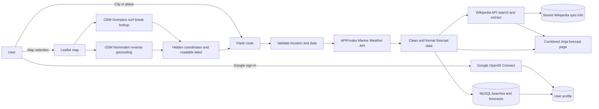
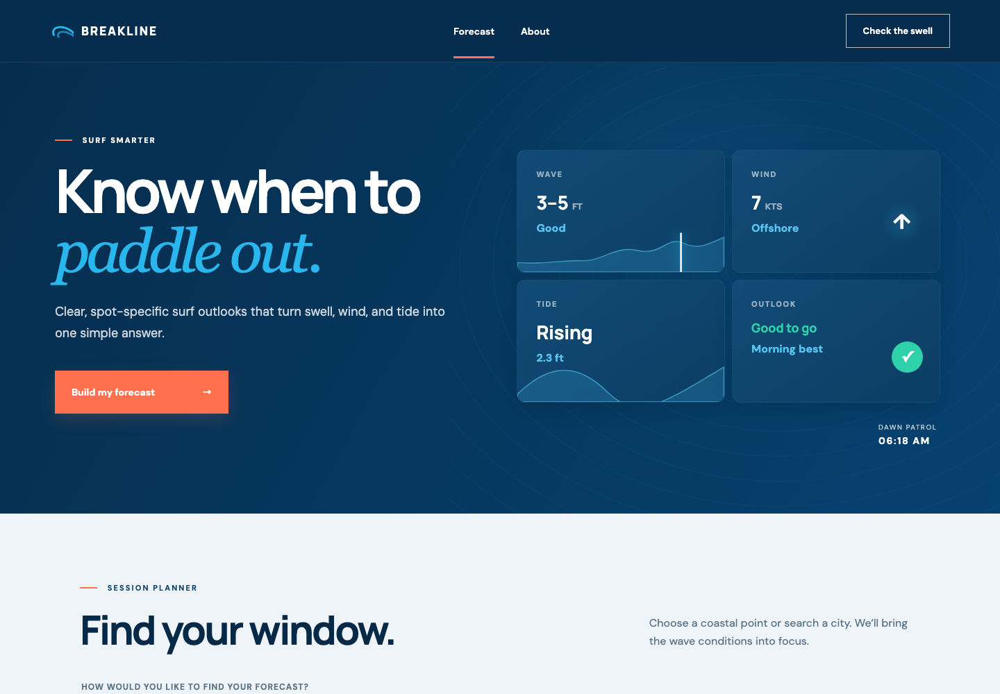
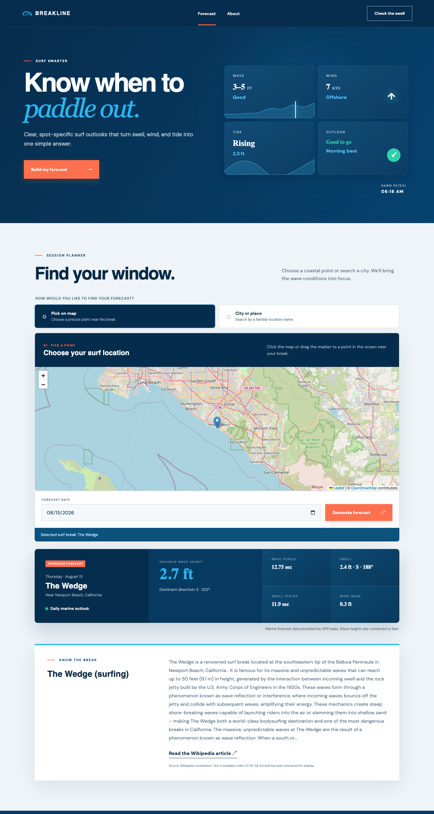
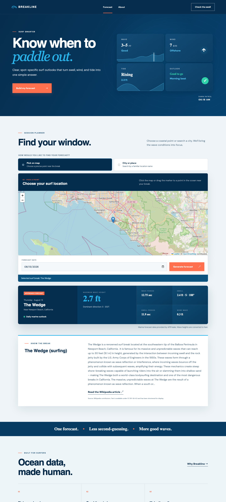

# Breakline Surf Forecasts

Breakline is a Flask web application that turns marine-weather data into a concise, human-readable surf outlook. Users can search by city or select a coastal point on an interactive map. The application combines an APIFreaks marine forecast, OpenStreetMap location data, and a short Wikipedia overview when a relevant beach, city, or surf-break article exists.

Users may optionally sign in with Google. Successful forecast requests made while signed in are linked to a private Breakline profile and displayed as request history.

Weather conditions are requested at runtime, map selections are enriched with nearby place and surf-break names, supporting destination information is requested from Wikipedia's MediaWiki Action API, and successful forecasts are persisted in MySQL through Flask-SQLAlchemy.

## External Information Sources

| Source | Endpoint or website | Purpose |
|---|---|---|
| APIFreaks Marine Weather API | `GET https://api.apifreaks.com/v1.0/weather/marine` | Retrieves hourly wave height, wave direction, wave period, swell, and wind-wave conditions by coordinates or location name. |
| OpenStreetMap raster tiles | `https://tile.openstreetmap.org/{z}/{x}/{y}.png` | Displays the interactive location picker. |
| OpenStreetMap Overpass API | `https://overpass-api.de/api/interpreter` with a fallback to `https://overpass.kumi.systems/api/interpreter` | Finds the nearest named OpenStreetMap feature tagged `sport=surfing`. |
| OpenStreetMap Nominatim | `GET https://nominatim.openstreetmap.org/reverse` | Converts a selected coordinate into a human-readable city or regional name. |
| English Wikipedia | `GET https://en.wikipedia.org/w/api.php` | Searches for a relevant beach, surf-break, or coastal-city page and returns its plain-text introductory extract through the MediaWiki Action API. |

APIFreaks requests authenticate through the server-side `X-apiKey` header. Browser requests to OpenStreetMap retain visible attribution, and Wikipedia API content links to its source article.

## Application Workflow



1. The user chooses either **Pick on map** or **City or place**.
2. A map click stores latitude and longitude in hidden form fields. Overpass attempts to identify a nearby surf break, while Nominatim supplies a readable city or region.
3. Flask validates the lookup mode, coordinates or location name, and forecast date.
4. The server requests an hourly marine forecast from APIFreaks and selects the user's requested hour.
5. Returned metric wave heights are converted to feet, directions are converted to cardinal labels, and missing measurements receive readable fallback text.
6. The server reuses fresh stored Wikipedia information when available. Otherwise, it asks the MediaWiki Action API for relevant articles and their plain-text introductory extracts, selects the best surf-related match, and stores it with revision and license provenance.
7. The beach and hourly forecast are inserted or updated in MySQL. One row is retained per beach, forecast date, and forecast hour.
8. When the user is signed in, the successful request is linked to their local profile. Anonymous requests are not tracked.
9. The forecast and optional Wikipedia overview are rendered together. Wikipedia or database failures never block the marine forecast.

## Information Model

Breakline stores normalized beaches and their hourly marine forecasts in MySQL. Repeating a request for the same coordinates, date, and hour refreshes that record; choosing a different hour creates a separate forecast.

| Entity | Attributes | Origin |
|---|---|---|
| Forecast request | lookup mode, location text, hidden latitude, hidden longitude, readable selected city, surf-break name, forecast date | Local user input and browser state |
| Marine location | city, state/province, country, latitude, longitude | External: APIFreaks |
| Marine conditions | maximum wave height, dominant wave direction, maximum wave period, swell height/direction/period, wind-wave height | External: APIFreaks |
| Surf-break match | name, latitude, longitude, distance from selected point | External: OpenStreetMap Overpass |
| Readable map location | city/town/village/municipality/county, state | External: OpenStreetMap Nominatim |
| Wikipedia overview | beach reference, page/revision IDs, article title, plain-text introductory summary, canonical source URL, license, and retrieval timestamp | Local MySQL record imported from the MediaWiki Action API |
| Beach | canonical display name, city, state/province, country, latitude, longitude, timestamps | Local MySQL record normalized from API and map data |
| Surf forecast | beach reference, forecast date, forecast hour, wave/swell/wind-wave measurements, source, retrieval timestamp | Local MySQL record imported from APIFreaks |
| User | Google subject identifier, verified email, display name, avatar URL, account and last-login timestamps | Local MySQL profile created from verified Google OIDC claims |
| Forecast request | user, beach, forecast, lookup mode, requested label, surf-break name, request timestamp | Local MySQL activity record created only for signed-in users |
| Surf-spot sample | name, region, sample wave/swell/wind/tide/rating fields in `data/surf_spots.json` | Local legacy prototype data; not used for live forecasts |
| Application configuration | API key, service base URLs, Flask environment, secret key | Local environment variables |

Wikipedia overviews are stored for 30 days by default and then refreshed on the next successful forecast request. The service also keeps a small in-process cache for repeated lookups during the running process.

## Environment Variables

Copy `.env.example` to `.env`. Never commit `.env` or an actual API key.

| Variable | Required | Description |
|---|---:|---|
| `APIFREAKS_API_KEY` | Yes | APIFreaks credential used only by the Flask server. |
| `SECRET_KEY` | Recommended | Flask signing secret. The development fallback is not appropriate for production. |
| `FLASK_ENV` | No | `development` or `production`; defaults to development configuration. |
| `APIFREAKS_BASE_URL` | No | Overrides the default APIFreaks base URL. Useful for testing. |
| `WIKIPEDIA_BASE_URL` | No | Overrides `https://en.wikipedia.org`. Useful for testing. |
| `WIKIPEDIA_USER_AGENT` | Recommended | Identifies the application and provides operator contact information as required by Wikimedia API policy. |
| `WIKIPEDIA_CACHE_DAYS` | No | Days to reuse stored spot information before refreshing it; defaults to `30`. |
| `GOOGLE_CLIENT_ID` | Yes for sign-in | OAuth 2.0 web-client ID from Google Cloud. |
| `GOOGLE_CLIENT_SECRET` | Yes for sign-in | OAuth 2.0 web-client secret from Google Cloud. |
| `DB_HOST` | Yes | MySQL host; defaults to `brian.cikeys.com`. |
| `DB_PORT` | No | MySQL port; defaults to `3306`. |
| `DB_NAME` | Yes | MySQL database/schema name. The database itself must already exist. |
| `DB_USERNAME` | Yes | MySQL username with permission to create and modify Breakline tables. |
| `DB_PASSWORD` | Yes | MySQL password. |
| `DATABASE_URL` | No | Complete SQLAlchemy URL that overrides the individual `DB_*` settings. |
| `API_KEY` | No | Legacy generic service configuration; not used by the marine forecast. |
| `AI_SERVICE_API_KEY` | No | Reserved for the placeholder AI service; not used by current features. |

Example `.env`:

```dotenv
SECRET_KEY=replace-with-a-random-secret
APIFREAKS_API_KEY=replace-with-your-apifreaks-api-key
WIKIPEDIA_USER_AGENT=Breakline/1.1 (https://brian.cikeys.com/; educational surf forecast)
WIKIPEDIA_CACHE_DAYS=30
GOOGLE_CLIENT_ID=replace-with-your-google-oauth-client-id
GOOGLE_CLIENT_SECRET=replace-with-your-google-oauth-client-secret
DB_HOST=brian.cikeys.com
DB_PORT=3306
DB_NAME=replace-with-your-database-name
DB_USERNAME=replace-with-your-database-username
DB_PASSWORD=replace-with-your-database-password
FLASK_ENV=development
```

## Installation Instructions

Prerequisites:

- Python 3.10 or newer
- Git
- A MySQL database and credentials with table-creation permission
- An APIFreaks account and Marine Weather API key
- Internet access for APIFreaks, OpenStreetMap, Leaflet assets, and Wikipedia

Setup:

```bash
git clone <repository-url>
cd profthoms-it401-final-project

python3 -m venv .venv
source .venv/bin/activate          # macOS/Linux
# .venv\Scripts\activate           # Windows PowerShell

pip install -r requirements.txt
cp .env.example .env
```

Edit `.env`, replace the credential placeholders, initialize the tables, and then start the app:

```bash
flask --app app init-db
python app.py
```

`init-db` creates all application tables in the configured database and applies supported schema upgrades. It does not create the MySQL database itself. Existing installations can run `flask --app app upgrade-db` to create newly added tables and apply schema upgrades.

### Google sign-in setup

1. In Google Cloud, create or select a project and configure its OAuth consent screen.
2. Create an OAuth client with application type **Web application**.
3. Add `http://127.0.0.1:5000/auth/google/callback` as an authorized redirect URI for local development. Google requires an exact URI match.
4. Add the issued client ID and secret to `.env`.
5. For production, register the HTTPS callback for the deployed domain, such as `https://your-domain.example/auth/google/callback`.

Only the `openid email profile` scopes are requested. Breakline validates the returned ID token through Authlib, requires a verified email, keys accounts by Google's stable `sub` claim, and does not store Google access or refresh tokens.

The default address is [http://127.0.0.1:5000](http://127.0.0.1:5000). If port 5000 is occupied, use Flask's CLI to choose another port:

```bash
flask --app app run --debug --port 5001
```

Core dependencies are Flask, Flask-SQLAlchemy, PyMySQL, Requests, python-dotenv, and pytest. Exact minimum versions are declared in `requirements.txt`.

Run the automated tests with:

```bash
python -m pytest -q
```

## Current Features

- **API integration:** Retrieves current-date through 16-day hourly forecasts from APIFreaks by city/place or coordinates.
- **Interactive map:** Uses Leaflet and OpenStreetMap tiles; map coordinates remain hidden from users.
- **Human-readable map selection:** Resolves the chosen point to a nearby city or region and attempts to identify a named surf break.
- **Wikipedia API integration:** Searches Wikipedia and retrieves plain-text introductory extracts plus page/revision provenance in one API request, then stores and reuses the most relevant result.
- **MySQL persistence:** Stores beaches by coordinate and upserts one APIFreaks forecast per beach/date/hour through Flask-SQLAlchemy.
- **Google sign-in:** Uses the server-side OpenID Connect authorization-code flow for optional user accounts.
- **Profile history:** Tracks successful forecast requests for authenticated users and shows the latest 100 requests on their profile.
- **Data cleaning:** Trims input, validates ranges and lengths, normalizes whitespace, truncates summaries, converts meters to feet, and converts degrees to cardinal directions.
- **User search and filtering:** Supports map or city lookup modes, only accepts current/future dates within the API's 16-day window, and filters OpenStreetMap results to named surfing features rather than shops, schools, or clubs.
- **Responsive presentation:** Combines forecast data, location context, and optional Wikipedia information in a mobile-friendly interface.
- **Error handling:** Presents user-safe messages and isolates optional-source failures from the primary forecast.

## Error Handling

| Failure | Application behavior |
|---|---|
| Missing `APIFREAKS_API_KEY` | No external weather request is made. The page explains that the server must be configured. |
| APIFreaks authentication error (`401`/`403`) | Displays a configuration message without revealing the key. |
| Invalid APIFreaks request (`400`) | Explains that the coordinates or date were rejected. |
| Location not found (`404`) | Reports that no forecast was found for the selected location. |
| Timeout, connection error, invalid JSON, or other API error | Displays a retry-friendly service-unavailable message. |
| Invalid coordinate | Enforces latitude `-90..90` and longitude `-180..180` on the server. |
| Invalid location text | Rejects blank values and values longer than 150 characters. |
| Invalid forecast date | Accepts only today through 16 days ahead. |
| Missing forecast fields | Displays `Not available` instead of failing template rendering. |
| Overpass unavailable or no surf-break match | Keeps the originally selected coordinate and falls back to its readable city/region when possible. |
| Reverse geocoding unavailable | Keeps the hidden coordinates and displays a generic location-selected message. |
| Wikipedia request failure or timeout | Omits the optional overview; the marine forecast still renders. |
| Invalid Wikipedia API response or no relevant result | Omits the optional overview; the marine forecast still renders. |
| Missing database credentials | Forecast persistence remains disabled; configure the `DB_*` settings and run `flask --app app init-db`. |
| Database connection or write failure | Rolls back the database transaction and logs the failure; the retrieved forecast still renders. |
| Missing Google credentials | Sign-in remains disabled and a configuration message is shown. Forecasting continues anonymously. |
| Google denial, invalid state/token, unverified email, or callback failure | No local session or user is created; the user receives a retry-friendly message. |

## Ethical Considerations

- **Attribution:** OpenStreetMap attribution remains visible on the map. Every displayed Wikipedia summary names Wikipedia contributors, links to the source article and CC BY-SA 4.0 license, and notes that the text was shortened.
- **Credentials:** APIFreaks and MySQL credentials remain server-side in `.env` and are never included in HTML, JavaScript, screenshots, or documentation.
- **Authentication privacy:** Google tokens are used only during the callback and are not stored. Profiles retain the minimum basic identity fields needed for login plus successful request history; anonymous requests are not associated with a user.
- **Rate limits:** Map lookups occur only after direct user actions. Requests use timeouts and cancellation, and the application does not bulk-download map or geocoding data. Nominatim's public service requires an application-wide maximum of one request per second; a production deployment should add server-side throttling/caching or use a dedicated provider.
- **Responsible API use:** The Wikipedia service uses an operator-identifying user agent, serial GET requests, Wikimedia cache hints, a 30-day database cache, a small memory cache, limited displayed text, and fails closed when expected data is missing.
- **Source limitations:** Wikipedia and OpenStreetMap are community-maintained sources. Their presence does not guarantee that a surf break is mapped, that an article exists, or that the information is complete.

## Known Limitations

- Public Overpass and Nominatim services are best-effort and may be slow, unavailable, or rate-limited.
- OpenStreetMap surf-break coverage varies by region. The nearest mapped `sport=surfing` feature may not be the user's intended break.
- Reverse geocoding finds the closest suitable mapped object, which may occasionally return a neighboring municipality.
- Wikipedia search ranking may select a city article when a dedicated surf-break article does not exist.
- The English Wikipedia is the only configured Wikipedia language source.
- Hourly APIFreaks data is shown; minutely forecasts are not exposed.
- Surf suitability is not scored. Break orientation, bathymetry, local hazards, wind weather, and tides require additional sources.
- External results are fetched during a page request, so slow sources can increase response time.
- There is no favorites interface, profile-editing interface, account-deletion workflow, migration framework, or automatic stale-forecast refresh yet.

## Screenshots

### Homepage



### API results


### Scraped results



### Combined interface



## Project Structure

```text
.
├── app.py
├── config.py
├── data/
├── models/
│   ├── beach.py
│   ├── forecast_request.py
│   ├── surf_forecast.py
│   ├── user.py
│   └── wikipedia_spot_info.py
├── routes/
│   ├── auth.py
│   └── main.py
├── services/
│   ├── marine_weather_service.py
│   ├── forecast_repository.py
│   ├── request_history_repository.py
│   ├── wikipedia_service.py
│   ├── wikipedia_repository.py
│   └── wikipedia_scraper.py  # backward-compatible import
├── static/
│   ├── map.js
│   └── style.css
├── templates/
├── tests/
├── .env.example
└── requirements.txt
```

## Future Database Work

The database-backed information layer stores beaches and hourly forecasts. Planned extensions include:

- Add source identifiers and aliases to normalized beach records.
- Read still-current forecasts from the database before making duplicate API calls.
- Add automatic background refreshes for stale Wikipedia information.
- Save OpenStreetMap surf-break matches and reverse-geocoded labels while respecting source terms.
- Add favorite breaks, saved forecast preferences, profile editing, and account deletion.
- Track external API failures for maintenance without storing secrets or unnecessary personal data.
- Add schema migrations and a scheduled refresh strategy for stale external information.

Persistent records will distinguish local user/application data from externally acquired data and retain source, retrieval time, and attribution metadata for every imported record.
