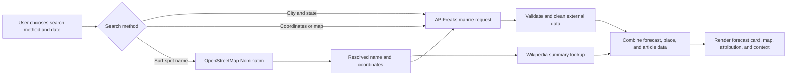

# Breakline Surf Forecasts

## Project Overview

Breakline is a Flask web application that helps surfers turn marine conditions into
a concise, location-specific daily outlook. Users can search by city and state,
enter latitude and longitude, choose a point on an interactive map, or search for a
surf spot by name.

The current version acquires information from external services instead of relying
only on local sample data. OpenStreetMap resolves surf-spot names to coordinates,
APIFreaks supplies daily marine forecast measurements, and Wikipedia provides an
optional plain-text introduction for a resolved surf spot. Breakline cleans and
combines these responses into one interface while retaining source attribution.

## External Information Sources

| Source | Endpoint | Purpose |
|---|---|---|
| APIFreaks Marine Weather API | `GET https://api.apifreaks.com/v1.0/weather/marine` | Retrieves daily wave, swell, and wind-wave measurements for a location and date. Requests use `location`, or `lat` and `long`, plus `startDate`, `endDate`, and `precision=daily`. |
| OpenStreetMap Nominatim | `GET https://nominatim.openstreetmap.org/search` | Resolves a user-entered surf-spot name, such as `County Line`, to a named OpenStreetMap feature and coordinates. |
| Wikipedia MediaWiki API | `GET https://en.wikipedia.org/w/api.php` | Retrieves an optional short, plain-text introduction and canonical article link for a resolved surf spot. |
| OpenStreetMap tiles | `GET https://tile.openstreetmap.org/{z}/{x}/{y}.png` | Supplies the map imagery used by the Leaflet location picker. |

### Website Content Acquisition

**Websites scraped: none.**

The application does **not** scrape HTML pages. Wikipedia information is acquired
through the official MediaWiki Action API using `prop=extracts`, `explaintext=1`,
and a three-sentence limit. This structured approach is more reliable and
responsible than depending on changing page markup. Consequently, there are no
HTML selectors or scraped HTML elements in the current implementation.

## Application Workflow



1. Flask validates the submitted location method and forecast date.
2. A city/state search goes directly to APIFreaks using its `location` parameter.
3. Coordinate and map searches send numeric `lat` and `long` parameters.
4. A surf-spot-name search first resolves the name through OpenStreetMap. The
   resulting coordinates are sent to APIFreaks, while the resolved name is used
   for an optional Wikipedia lookup.
5. Service classes validate response structures and return normalized data to the
   route.
6. The route combines the results and renders the Jinja template. Optional source
   failures do not prevent the marine forecast from being displayed.

## Information Model

Breakline currently uses transient Python dictionaries rather than a database.

| Entity | Important attributes | Origin |
|---|---|---|
| Forecast request | `location_type`, `city`, `state`, `spot_name`, `latitude`, `longitude`, `forecast_date` | Local user input |
| Resolved surf spot | `name`, `latitude`, `longitude`, `region`, `osm_url` | External: OpenStreetMap |
| Marine forecast | `wave_height_max`, `wave_direction_dominant`, `wave_period_max`, `swell_wave_height_max`, `swell_wave_direction_dominant`, `swell_wave_period_max`, `wind_wave_height_max`, `wind_wave_direction_dominant`, `wind_wave_period_max` | External: APIFreaks |
| Display forecast | `wave_height`, `rating`, `summary`, formatted condition labels and values | Locally derived from APIFreaks data |
| Wikipedia context | `title`, `extract`, `url` | External: Wikipedia |
| Local sample surf spot | `name`, `region`, coordinates, sample wave/swell/wind/tide values, `rating`, `summary` | Local: `data/surf_spots.json`; retained as sample/reference data |

### Data Cleaning and Transformation

- Metric wave heights are converted from meters to feet.
- Direction degrees are converted to eight-point compass directions.
- Period values are formatted in seconds.
- Null readings are replaced with an em dash or an unavailable message.
- Wave height is translated into a simple `Small`, `Moderate`, `Solid`, or `Heavy`
  planning label.
- City/state strings are trimmed and limited to 100 characters.
- Coordinates must be finite numbers within valid latitude and longitude ranges.
- OpenStreetMap candidates are normalized and restricted to exact named beach or
  surf-related matches.
- Wikipedia extracts are requested as plain text and limited to three sentences.

## Environment Variables

Copy `.env.example` to `.env`. Never commit `.env` or place real secrets in this
README.

| Variable | Required | Description |
|---|---:|---|
| `APIFREAKS_API_KEY` | Yes | Secret key used in the APIFreaks `X-apiKey` request header. |
| `SECRET_KEY` | Production only | Flask signing key. The local default is for development only. |
| `FLASK_ENV` | No | `development` or `production`; defaults to development. |
| `APIFREAKS_BASE_URL` | No | Overrides the APIFreaks base URL. |
| `NOMINATIM_BASE_URL` | No | Allows OpenStreetMap Nominatim to be replaced without an application update. |
| `NOMINATIM_USER_AGENT` | Recommended | Identifies the application to Nominatim. A deployed app should include valid contact information. |
| `WIKIPEDIA_API_URL` | No | Overrides the English Wikipedia MediaWiki API endpoint. |

Example `.env` file:

```dotenv
APIFREAKS_API_KEY=replace_with_your_key
SECRET_KEY=replace_with_a_random_production_secret
FLASK_ENV=development
NOMINATIM_USER_AGENT=Breakline/1.0 (contact@example.com)
```

## Installation Instructions

### Prerequisites

- Python 3.10 or newer
- Git
- An APIFreaks API key with access to the Marine Weather API

### Setup

1. Clone the repository and enter the project directory:

   ```bash
   git clone <repository-url>
   cd profthoms-it401-final-project
   ```

2. Create and activate a virtual environment:

   ```bash
   python3 -m venv .venv
   source .venv/bin/activate
   ```

   On Windows PowerShell, activate it with:

   ```powershell
   .venv\Scripts\Activate.ps1
   ```

3. Install the required Python dependencies:

   ```bash
   python -m pip install -r requirements.txt
   ```

   The project currently depends on Flask, Requests, python-dotenv, and pytest.
   Leaflet is loaded in the browser from its published CDN build.

4. Create the local environment file:

   ```bash
   cp .env.example .env
   ```

5. Add the APIFreaks key to `.env` without quotes or extra spaces:

   ```dotenv
   APIFREAKS_API_KEY=replace_with_your_key
   ```

6. Start the application:

   ```bash
   python app.py
   ```

7. Open [http://127.0.0.1:5000](http://127.0.0.1:5000).

### Tests

```bash
python -m pytest -q
```

Tests mock external HTTP calls so they do not consume APIFreaks credits or depend
on third-party availability.

## Current Features

- **API integration:** Daily APIFreaks marine forecasts and Wikipedia summaries.
- **External information acquisition:** OpenStreetMap surf-spot lookup and
  structured Wikipedia content retrieval. Raw website HTML scraping is not used.
- **Interactive map:** Users can click a Leaflet map or drag its marker to select
  forecast coordinates.
- **Search options:** City/state, typed coordinates, map-selected coordinates, and
  surf-spot-name lookup.
- **Data cleaning:** Unit conversion, compass conversion, null handling, text
  normalization, short Wikipedia extracts, and display-oriented ratings.
- **Source combination:** Forecast, resolved location, map, attribution, and
  Wikipedia context appear in one interface.
- **Caching and rate control:** Repeated Nominatim and Wikipedia lookups are cached;
  Nominatim requests are serialized and limited to one per second application-wide.
- **Error handling:** Invalid input and external service failures produce readable
  messages without exposing secrets or server exceptions.

## Error Handling

| Failure | Application behavior |
|---|---|
| Missing `APIFREAKS_API_KEY` | No forecast request is attempted. The interface reports that the key is not configured. |
| APIFreaks timeout, HTTP error, invalid JSON, or missing daily forecast | The service raises `MarineWeatherError`; the route displays that no marine forecast is available. |
| Invalid date | The user is asked to choose a date within the current 16-day forecast window. |
| Missing city/state | The user is asked to enter both values. |
| Invalid coordinates | Latitude must be from `-90` to `90`; longitude must be from `-180` to `180`. NaN and infinity are rejected. |
| Surf spot not found | The interface recommends entering the full beach or break name. No unrelated OpenStreetMap result is silently selected. |
| Nominatim failure | The surf-spot lookup is stopped and a not-found message is displayed; APIFreaks is not called with unverified coordinates. |
| Wikipedia failure or no relevant article | The optional context panel and link are omitted; the forecast continues normally. |
| Missing external fields | Missing measurements display as unavailable rather than causing a template error. |
| Missing HTML elements | Not applicable because the app does not parse third-party HTML. Missing JSON objects and fields are handled explicitly instead. |

## Ethical Considerations

- OpenStreetMap attribution is displayed on the map and beside surf-spot search
  results. Wikipedia summaries include a direct article link.
- Nominatim lookups are user-triggered, cached, and limited to one request per
  second across the application. The app does not implement prohibited client-side
  autocomplete or bulk geocoding.
- The Nominatim base URL is configurable so a larger deployment can move to a
  hosted provider or self-managed instance.
- OpenStreetMap tiles retain visible copyright attribution and are requested only
  for the map viewport selected by a user.
- Wikipedia is accessed through its official API; the application does not scrape
  page markup, copy full articles, or remove source links.
- APIFreaks credentials remain server-side and are excluded from version control.
- Forecasts are presented for planning only. Users should verify local conditions,
  advisories, and their own ability before entering the water.

Relevant policies and documentation:

- [Nominatim Usage Policy](https://operations.osmfoundation.org/policies/nominatim/)
- [OpenStreetMap Tile Usage Policy](https://operations.osmfoundation.org/policies/tiles/)
- [MediaWiki Search API](https://www.mediawiki.org/wiki/API:Search)
- [APIFreaks Marine Weather API](https://apifreaks.com/api/marine-weather)

## Known Limitations

- Search results are limited by the names and tags available in OpenStreetMap.
- Duplicate surf-spot names are not yet presented as a list for user selection.
- The public Nominatim service is suitable only for moderate, user-triggered use;
  a production-scale deployment needs another provider or a self-hosted instance.
- Wikipedia enrichment currently searches English Wikipedia and is unavailable for
  spots without a relevant article.
- Forecast precision is currently daily, and APIFreaks limits the selectable range
  to 16 days.
- Some locations, especially inland or poorly modeled points, may contain null
  marine measurements.
- Data and search history are not persisted. In-memory caches reset when the
  application restarts and are not shared across multiple server processes.
- The application does not currently support user accounts, saved spots, favorite
  forecasts, or historical comparisons.

## Screenshots

Screenshot image files have not yet been added to the repository. Before final
submission, create `docs/screenshots/` and capture the following views at a
consistent browser size:

| Required capture | Suggested filename | What it should demonstrate |
|---|---|---|
| Homepage | `docs/screenshots/homepage.png` | Breakline landing page and forecast form. |
| API results | `docs/screenshots/api-results.png` | A live APIFreaks forecast showing wave, swell, and wind-wave values. |
| Externally acquired context | `docs/screenshots/wikipedia-result.png` | The “About this surf spot” Wikipedia extract and source link. |
| Combined interface | `docs/screenshots/combined-interface.png` | Surf-spot-name search, resolved map marker, forecast, attribution, and Wikipedia context together. |

After adding the files, embed them here with relative paths, for example:

```markdown

```

Do not include an API key, `.env` contents, browser developer tools, or other
sensitive information in a screenshot.

## Future Work: A3 Persistent Storage

Assignment 3 will add persistent storage so externally acquired information can be
reused and analyzed across sessions. The planned extension is to introduce a
relational database and ORM models for:

- normalized surf spots and their OpenStreetMap identifiers;
- saved user searches and favorite locations;
- forecast snapshots with retrieval timestamps and source metadata;
- Wikipedia article references rather than copied full articles; and
- cache timestamps that allow stale external data to be refreshed safely.

Database-backed storage will reduce duplicate external requests, support forecast
history and comparisons, and make saved locations available after an application
restart. Migrations, expiration rules, and source attribution will be included so
stored information remains traceable and current.

## Project Structure

```text
.
├── app.py
├── config.py
├── data/
│   └── surf_spots.json
├── routes/
│   └── main.py
├── services/
│   ├── marine_weather_service.py
│   ├── openstreetmap_service.py
│   └── wikipedia_service.py
├── static/
│   ├── forecast.js
│   └── style.css
├── templates/
│   ├── base.html
│   └── index.html
├── tests/
├── .env.example
└── requirements.txt
```
